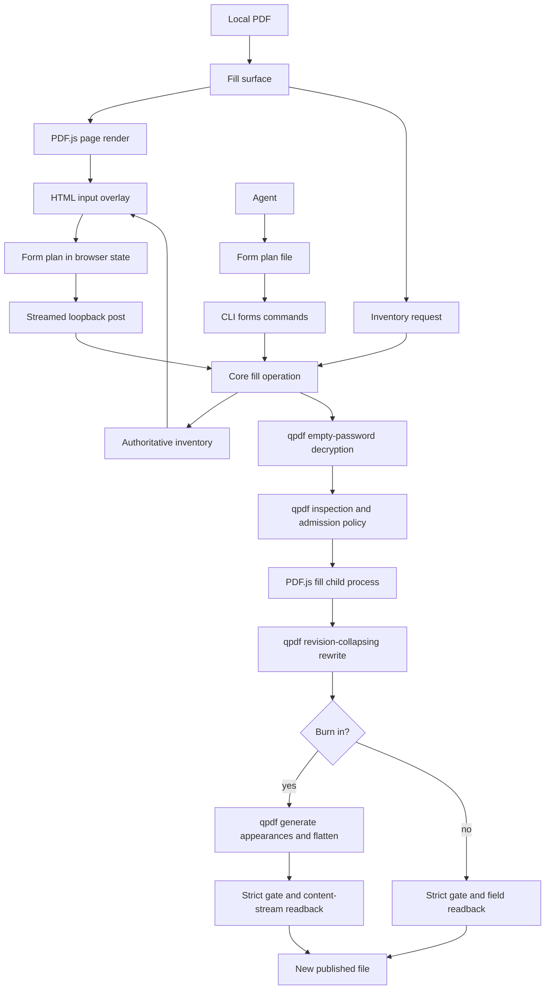
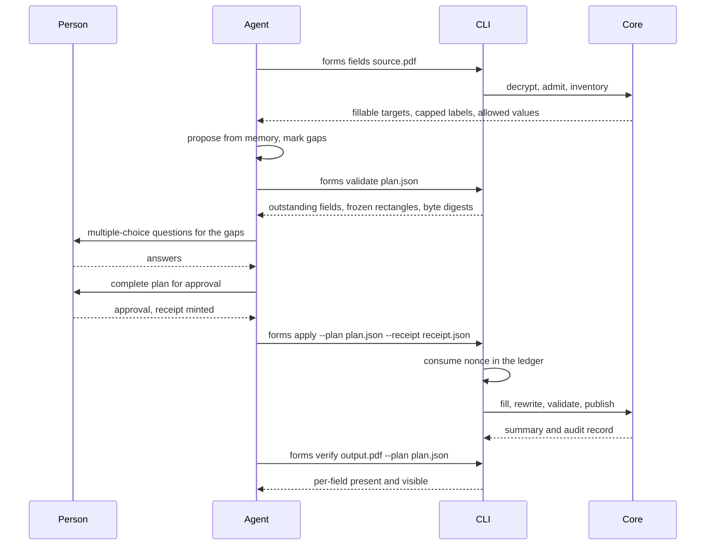
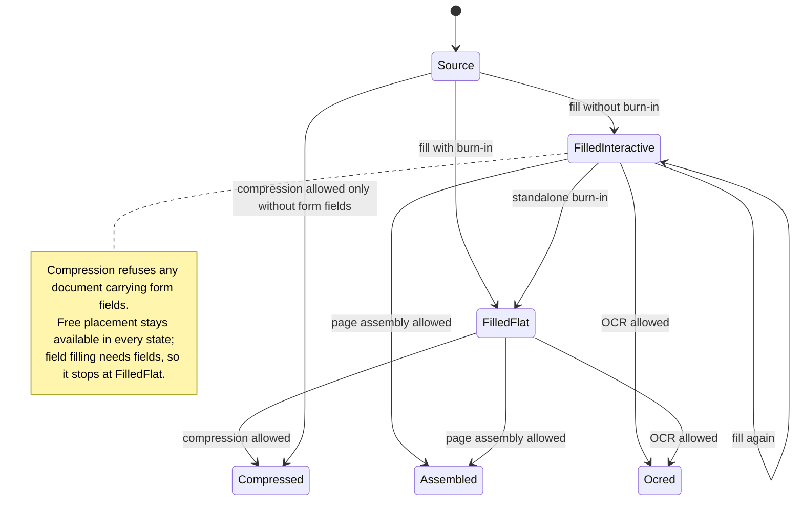
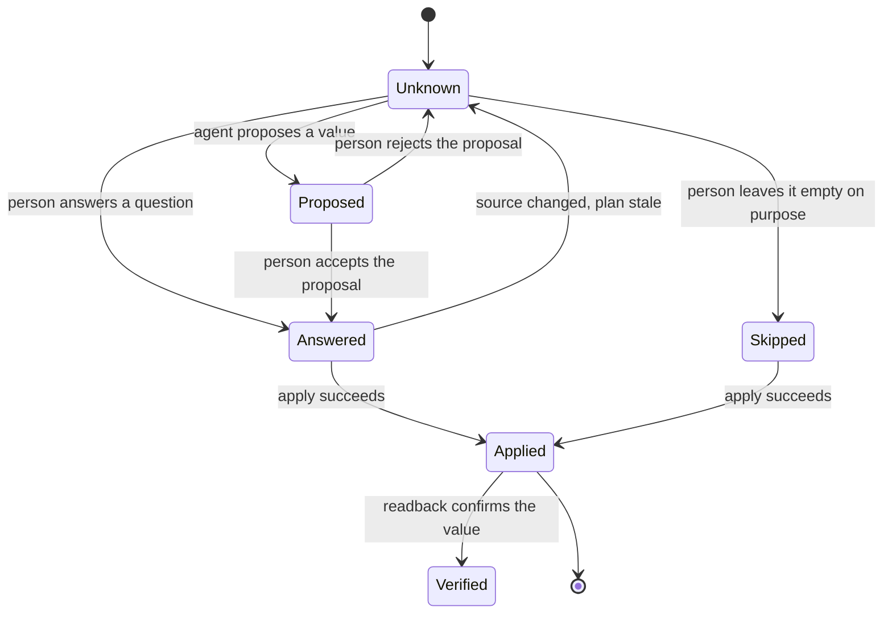
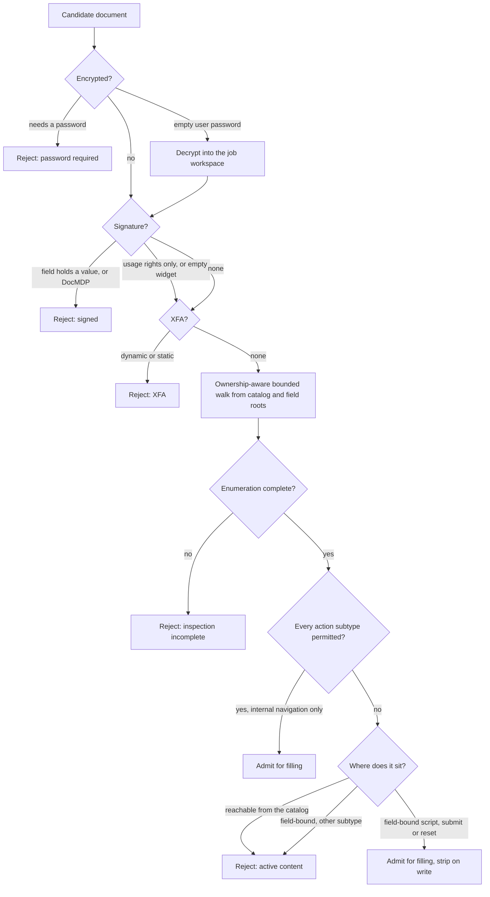

# PDF Form Filling and Signing - Plan

## Goal Capsule

| Field | Value |
|---|---|
| Objective | A person can fill in and sign a PDF on their own machine, by hand or by handing the job to an agent, and receives a new document that carries the values they approved and nothing else. The approval gate is tamper-evident rather than tamper-proof: it defends against an agent that errs or drifts, not against a hostile local process, which on this machine could act directly anyway. (KTD7) |
| Means | PDF.js writes field values and placements inside a bounded child process, qpdf decrypts, admits, rewrites and validates every artifact, and an approval-bound plan file is the agent's only path to writing. (KTD1, KTD2, KTD7) |
| Authority | The current request, the session-confirmed scope, this Product Contract, and the existing page-editing and OCR contracts this work must not break. |
| Execution profile | Start on `feat/pdf-form-filling` at current `main`. Clear the static-mock selection gate, then land contracts, admission, engine, core, CLI, server, browser, skill and evidence in the order given under Sequencing. |
| Stop conditions | Stop before commenting and highlighting, correcting existing body text, cryptographic signing, uploaded signature images, agent-placed signatures, agent-driven free placement, and any cloud processing. Stop all production UI work after the static mocks until Lennart selects a direction; the backend contract and admission units are not behind that gate. |
| Tail ownership | Finish with measured browser and core evidence, corrected documentation including the forms-compatibility, single-mutation and fail-closed claims this work makes false, a documented lifecycle for every file that holds personal data, and no abandoned prototype code. |

---

## Product Contract

### Summary

Add a fill-and-sign workflow beside compression, page editing and OCR.
A person fills existing form fields, and places text, checkmarks and a drawn signature on pages that have no fields.
An agent can do the field work instead, and the command contract is what keeps its values from reaching a document unapproved. That contract is enforceable against an agent that errs or drifts; it is not a defence against a hostile process on the same machine, and KTD7 states where it stops.
Editing existing body text stays outside this plan.

### Problem Frame

Filling a PDF is the everyday task this product still forces a user to leave for.
Page editing deliberately deferred forms in `docs/plans/2026-09-04-2140-feat-lightweight-pdf-page-editing-plan.md`, and treats them as inert structures that may not survive export.
The result is that the compressor handles the rare job well and the common one not at all.

The gap is sharper for agent work.
Filling a tax, bank or insurance form is repetitive, language-shaped, and drawn from facts an agent usually already holds.
It is also the point where an agent handles a person's name, address, tax number and bank details, so an unreviewed automatic fill is the wrong shape even when it is technically easy.

Four properties of the existing code block the feature outright rather than merely complicating it.
The active-content classifier reports an ordinary German form as signed, because an empty signature widget contains the string it scans for.
The same classifier runs on produced files, so a correctly filled form would also fail on the way out.
That classifier is a blocklist of ten strings that never inspects annotation activation actions at all, so it is not the backstop a loosening could lean on.
And documents that open without a password but carry permission restrictions are rejected before any form logic runs, which is most of the target corpus.

### Key Decisions

- KD1. **The product boundary is filling and signing, not annotating or authoring.** (session-settled: user-directed — chosen over a general PDF editor: the aim is what a person does in Adobe Reader, without its weight.) Governs R1, R2, R4, R6.
- KD2. **The agent proposes, the person approves.** (session-settled: user-directed — chosen over an agent that fills autonomously: the values are the person's own identity documents.) Governs R8, R9, R10, R11.
- KD3. **Personal data lives in the agent's memory, not in the app.** (session-settled: user-directed — chosen over an app-owned profile store: a persistent profile would be the first durable personal data in a deliberately ephemeral product.) Governs R7, R29.
- KD4. **Signing is reserved to the person.** (session-settled: user-directed — chosen over allowing an approved agent placement: a misplaced signature is far harder to notice than a wrong text value.) Governs R6.
- KD5. **Perceived speed is a product property with measured evidence.** (session-settled: user-directed — chosen over leaving browser budgets unverified like the page editor's: speed is the feature's core claim and this repository does not assert unmeasured numbers.) Governs R24, R25, R26.
- KD6. **Documents that open without a password are accepted even when encrypted.** (session-settled: user-directed — chosen over keeping the blanket rejection: Reader-extended forms with an empty user password are most of the corpus this feature exists for.) Governs R17.

### Requirements

**Filling and signing**

- R1. A person must be able to fill a local PDF's existing form fields in the web app without sending document content to a third-party service.
- R2. A person must be able to place text, checkmarks and a drawn signature at a chosen position on any page, including documents that contain no form fields at all.
- R3. Filling must always produce a new PDF and must never modify or replace a source file.
- R4. A person must be able to burn the result in, so values become page content that no viewer treats as editable.
- R5. Without that choice, filled fields must remain interactive form fields.
- R6. Placing a signature must be available to the person in the browser only, and must be unavailable to the agent path.

**Agent path and approval**

- R7. The CLI must emit a machine-readable inventory of every fillable target: a stable identifier, its widget set, a display label with the source of that label, type, allowed values, required, read-only, computed and password flags, page, and current value.
- R8. Values from an agent must reach a document only through a plan file whose approval the person granted.
- R9. `apply` must accept only a plan file and a receipt; no option may change what is written, including the destination and the overwrite decision.
- R10. The plan file must carry a per-field status, so an interview the person left half-finished is distinguishable from a field the agent forgot.
- R11. `apply` must be all-or-nothing: any error rejects the whole plan, and warnings never reduce it to a subset.
- R12. A separate `verify` step must read the delivered file back independently of the writer and report, per field, whether the approved value is actually present and visible.
- R13. Machine-readable output must omit every field value by default, including current values in the inventory and both sides of a verification mismatch, and report a digest instead unless the caller asks for values.
- R14. The repository must ship an agent skill that encodes the memory, proposal, approval and interview loop.
- R35. Labels, tooltips and choice options read out of a document must be treated as untrusted content: length-capped, stripped of control characters, and marked as document-derived wherever they are emitted.

**Document admission and integrity**

- R15. Filling must admit documents whose scripts and submit actions are reachable only from form fields, and the delivered file must contain none of them.
- R16. A signature field without a value must not be treated as a signed document, and a usage-rights signature must not block filling; a signature field holding a value, and any document-modification permission signature, must stay blocked everywhere.
- R17. A document that opens with an empty user password must be admitted for filling, and the delivered file must carry no encryption; a document that needs a real password must stay rejected.
- R18. Every XFA document, dynamic or static, must be refused with a distinct reason that names XFA. (session-settled: user-directed — chosen over admitting static XFA with a datasets stream: nothing in this plan writes the XFA representation, so a filled static XFA would show the new value in one viewer and the stale one in another.)
- R19. Every fill must end with a rewrite that collapses document revisions, so the delivered file contains no value from an earlier state of the work.
- R20. Before publication the delivered file must pass the strict gate, and its values must be read back: from the fields when it is still interactive, and from the page content when it has been burned in.
- R21. Compression must refuse a document that carries form fields, because the smaller-wins comparison is not value-preserving between two such documents. Page assembly and OCR must keep their form-field policy unchanged; like every operation they adopt the stricter active-content classification of KTD4 and therefore start refusing the AE13 document.
- R22. The claim that forms may not survive page assembly must be corrected to match qpdf's actual behaviour at the supported floor, and covered by a test.
- R36. A file that was filled without burning in must be burnable in afterwards through a standalone operation, so choosing to keep fields editable is never a dead end.

**Speed and resource use**

- R23. Typing, checking, choosing and placing must change browser state only, with no HTTP request and no child process.
- R24. Fill code and its page renderer must load only when the fill surface opens, and must not enter the compressor shell's eager bundle.
- R25. The full-page render must have its own memory budget, separate from the thumbnail grid's.
- R26. Browser-side timing claims must come from a reproducible measurement, never from assertion, split by what each environment can honestly prove: continuous integration runs the harness on its own hardware against a regression budget, and the reference-machine numbers come from the same harness driven by a single scripted command on the reference Mac, recorded with its environment metadata.

**Local security and lifecycle**

- R27. Values must be written as text only, must be rejected when they carry control characters or exceed the field's limit, and must survive the write unchanged byte for byte.
- R28. The fill engine must run as a bounded child process with an explicit heap cap, timeout, output-size budget and process-group termination.
- R29. Every file this feature creates that holds personal data — the plan, the receipt, the audit record and the decrypted working copy — must be created owner-readable only, must have a documented lifecycle and a command that removes it, and must never have its contents logged.
- R30. A receipt must be single-use and time-bounded, must bind the exact bytes of the plan and of the source, and must be consumed before the write begins.
- R31. The fill route must reuse the existing loopback boundary, session binding and resource caps, and its job directories must be swept like the existing ones.

**Surfaces and dependency contract**

- R32. Web app and CLI must use the same core fill operation, the same plan contract and the same inventory contract.
- R33. The feature must add no runtime dependency that is new to this repository, and must record what its existing dependencies pull in transitively. The browser driver of KTD16 is the single permitted exception: a development-only dependency that must not appear in any shipped package's dependencies.
- R34. Leaving the fill surface while values are unsaved must warn before the state is lost, and unsaved values must never be persisted anywhere.
- R37. The fill surface must escape the application shell's fixed width, and only the fill surface: `apps/web/src/styles.css:12` caps `#app` at `min(760px, calc(100vw - 32px))`, which no other surface needs to leave.
- R38. A single-character keyboard shortcut such as the field-list key must be disableable, remappable, or active only while a component holds focus, per WCAG 2.2 Character Key Shortcuts.

### Success Criteria

- SC1. The compressor shell's eager JavaScript stays within its existing budget, and no fill byte is reachable from the built entry document.
- SC2. The complete lazy asset graph, including the fill surface and any renderer assets it admits, stays at or below the existing 2 MB gzip ceiling.
- SC3. A cold 8-page, 2 MB reference form shows its first page and an editable first field within 1.5 seconds at p95 on the reference development Mac, recorded by the repository's own harness from a scripted run on that machine.
- SC4. Typing into a field, toggling a checkbox and dragging a placement stay below 50 ms at p95 on a 200-field form and start no fetch and no child process.
- SC5. Core fill of a 100-field form, including decryption, admission, write, revision-collapsing rewrite, validation and readback, stays at or below 4 seconds at p95 on fixed corpora.
- SC6. Source hashes are unchanged across success, warning, failure, cancellation, timeout and client-disconnect scenarios.
- SC7. Every value the fill operation introduces comes from the approved plan, and no superseded or rejected proposed value survives, proven by filling a document twice with different values and asserting that the set of strings the second fill added over the first contains only approved values and no value from the first.
- SC8. SC3 and SC4 are produced by the repository's own browser harness and recorded with the same environment metadata as the existing benchmark, not listed as unverified, and the same harness runs in continuous integration against a regression budget sized for its own hardware so a slowdown fails a build rather than waiting for the next manual run.

### Key Flows

- F1. **Fill and sign by hand**
  - **Trigger:** A person opens a local PDF in the fill surface.
  - **Steps:** The browser renders the page, requests the authoritative inventory, overlays inputs on the fields it describes, accepts typed values and placements as browser state, then sends the source and one plan to the loopback server on export.
  - **Outcome:** A new validated PDF, optionally burned in, is available for one-time download.
  - **Covered by:** R1, R2, R3, R4, R5, R6, R23, R32.
- F2. **Fill by agent**
  - **Trigger:** A person asks an agent to fill a form.
  - **Steps:** The agent reads the field inventory, proposes values from its own memory, asks multiple-choice questions for what it lacks, has the person approve the resulting plan, applies it, and verifies the result.
  - **Outcome:** A new PDF containing exactly the approved values, plus an audit record of what was approved.
  - **Covered by:** R7, R8, R9, R10, R11, R12, R13, R14, R30, R35.
- F3. **Approve in the browser, apply from the terminal**
  - **Trigger:** An agent has written a plan and the person wants to see the values on the page before approving.
  - **Steps:** The person opens the plan in the fill surface, sees every proposed value in position, approves, receives a receipt file, and hands its path to the agent.
  - **Outcome:** `apply` accepts the receipt exactly once, for that plan, that source and that destination.
  - **Covered by:** R8, R9, R30, R32.

### Acceptance Examples

- AE1. **Covers F1.** Given a form with a text field, a checkbox whose on-state is not `Yes`, and a radio group, when the person fills all three and exports, then the delivered file shows all three set and the source hash is unchanged.
- AE2. **Covers F1.** Given a scanned PDF with no form fields, when the person places two text items and a drawn signature and burns the result in, then the placed content is present in the page content stream at the chosen positions.
- AE3. **Covers F2.** Given an agent proposes values and the person approves, when the agent then edits one value in the plan file and applies, then the command refuses because the receipt no longer matches the plan bytes.
- AE4. **Covers F2.** Given an approved plan, when `apply` runs a second time with the same receipt, then it refuses because the receipt was already consumed.
- AE5. **Covers F2.** Given a form where the tooltip is empty and the field name is opaque, then the inventory reports that no label could be derived, so the agent asks rather than guesses.
- AE6. **Covers F1.** Given a document is filled, corrected, and filled again, when every string in the delivered file is extracted, then no superseded value appears anywhere in it.
- AE7. **Covers F1.** Given a form whose fields carry format and validate scripts, when it is filled, then filling succeeds, the delivered file contains no script or submit action, and the result reports that the document's own arithmetic did not run.
- AE8. **Covers F1.** Given a Reader-extended form carrying a usage-rights signature and an empty user password, when it is filled, then it is admitted, the delivered file is unencrypted, and the result reports that the extended usage rights are gone.
- AE9. **Covers F1.** Given a dynamic XFA form, and separately a static XFA form carrying a datasets stream, when either is opened, then it is refused with a reason that names XFA rather than failing generically.
- AE10. **Covers F2.** Given the person answered three of seven questions and stopped, when validation runs again, then it re-asks only the four outstanding fields and refuses to apply.
- AE11. **Covers F1.** Given the field font cannot render a value's characters, then the fill fails with a stated reason instead of delivering a document whose fields are set but visually blank.
- AE12. **Covers F1.** Given a field has widgets on two pages, when it is filled, then both widgets show the value.
- AE13. **Covers F1.** Given a document whose only active content is a link action pointing at a remote address, then every operation refuses it, including the ones that accept it today.
- AE14. **Covers F2.** Given a field tooltip contains text shaped like an instruction to the agent, then the inventory emits it as capped, control-character-free, document-derived content, and the skill treats it as data.

### Scope Boundaries

In scope:

- Filling existing form fields, and placing text, checkmarks and a drawn signature on any page.
- Optional burning-in, a standalone burn-in for an artifact filled without it, an agent path with an enforced approval step, and an independent readback.
- The admission and integrity corrections that filling requires, applied consistently to inputs and outputs, including the action-subtype allowlist that closes an existing hole.
- A reproducible browser measurement for the timing claims this feature makes.

#### Deferred to Follow-Up Work

- Uploading a signature image. The pinned PDF.js gates image embedding on a browser canvas capability that Node does not provide, and its stamp path raises a type error rather than degrading. Closing this means either embedding the image stream in the child directly or promoting the native canvas package that already sits in the tree as an optional transitive dependency. The drawn signature path needs neither.
- Agent-driven free placement on pages without fields. Coordinate judgement without sight of the page is the weakest link in the design; rendered field crops or OCR word boxes are the natural anchor once the field path is proven.
- Comments, highlights, sticky notes and ink drawing as document annotations.
- Correcting or reflowing existing body text, redaction, and cryptographic signing.
- Running a document's own calculation scripts. Scripting stays disabled, so calculated fields keep whatever value is written into them.
- Filling static XFA. It needs a writer that updates the AcroForm field and the XFA datasets stream together and reads both back, which is a separate piece of work; until then a named refusal is the honest answer for a deprecated format.
- An MCP server. The CLI plus the shipped skill is the agent surface.
- Filling across a multi-source merged workspace, and filling a selection of pages.
- A per-install secret that would make receipts unforgeable. See KTD7 for why the current design stops at tamper-evidence.

---

## Planning Contract

### Key Technical Decisions

- KTD1. **PDF.js writes and qpdf governs; no new runtime dependency is added.** `pdfjs-dist` 6.3.289 is already an exact-pinned dependency and exposes `getFieldObjects`, `annotationStorage`, `saveDocument`, `hasJSActions` and `isPureXfa`, and runs in Node. qpdf 12.4.1 keeps inspection and validation and gains three roles: an empty-password decryption pass, appearance generation before flattening, and the revision-collapsing rewrite in KTD3. Two limits of the writer bound the product rather than the implementation: image embedding requires a browser canvas capability absent in Node, which is why an uploaded signature image is deferred and a drawn signature is not; and text appearances need the installed standard font data resolved explicitly, because nothing in the current app configures it. Rejected: `pdf-lib`, unmaintained since mid-2024 with its last release in 2021; `@cantoo/pdf-lib`, alive but a new dependency for a capability already shipped; `@libpdf/core`, whose annotation read, write and flatten are stated as not yet implemented, which is exactly the flat-page half; `mupdf`, at 14 MB, which is the whole rejection on its own: KTD19 admits WebAssembly for the renderer's image codecs, so the policy is no longer the argument, the size against the 2 MB lazy ceiling of SC2 is; `pdfcpu`, a fourth native tool that duplicates qpdf and cannot place free content; and `qpdf --update-from-json`, which would require hand-writing text appearance streams including default-appearance parsing, quadding, multiline and comb layout. This owns R1, R2, R4, R33.
- KTD2. **The fill engine runs as a bounded child process behind the existing native adapter.** Not for output-size enforcement: the size check the plan needs works equally well in-process, and the existing candidate-file poller cannot see a single terminal write either way. The three real reasons are heap containment, termination, and reuse. `saveDocument` allocates the source, the full output and the intermediate buffer at once at the end, so an in-process failure kills the long-lived local server and takes the native slot, the session store and the retained-output registry with it. PDF.js parses on the calling thread in Node, so no abort signal can interrupt it, and without a killable child the route's timeout and its disconnect handling would be claims the code cannot honour. Expressing the child through the existing native runner seam means the minimal environment, closed stdin, private working directory, timeout and test double all apply unchanged, where a worker thread would add a second lifecycle and cancellation mechanism beside the first. Three costs follow and are owned by U11: the child entry must resolve relative to its own module rather than the working directory, which differs between source and built layouts; the heap cap must be an argument rather than an environment variable, because the minimal environment deliberately drops it; and a child killed for memory exhaustion must surface as its own code rather than a generic engine failure. This owns R28 and SC5.
- KTD3. **Every fill ends with a revision-collapsing rewrite, so qpdf is required for filling.** `saveDocument` performs an incremental update: it copies the original bytes and appends a revision. Without a rewrite the delivered file is the input plus a diff, and every superseded value, including ones the person rejected during an interview, is recoverable with a single command. The pipeline therefore always runs a qpdf rewrite, and only the rewritten file is validated and published. That rewrite uses stream compression but must not generate object streams, which is where it departs from page assembly: packing objects into streams renumbers them, and object numbers are the field addressing of KTD5, so packing would break the identity between the inventoried source and the delivered file and the readback could no longer find what it approved. (corrected 2026-09-13 against the implementation, which is right and this sentence was not.) There is consequently no degraded path that fills without qpdf. This owns R19 and SC7.
- KTD4. **Active content is an allowlist of action subtypes over a bounded reachability walk, and one policy function decides admission per operation.** The current classifier stringifies the object graph and tests ten fixed strings. It never reads the annotation activation entry and never enumerates action subtypes, so a document whose only action opens a remote address is classified as carrying no active content and passes every gate today. Replace the blocklist with its inverse: any object carrying an action subtype outside a short permitted list is active content, wherever it sits. The permitted list is `/GoTo` alone: internal navigation is the one subtype that carries no capability. Every other subtype is active content, reported with a scope. Determine where an action sits by walking from two root sets — the catalog and the reconstructed field tree — with a visited set, a node budget and cycle detection, because action chains, objects shared between a widget and the catalog, and non-terminal parent fields absent from the form section all defeat a per-object test. The two walks must be ownership-aware, or the distinction collapses: a widget annotation is reachable from the catalog through the page tree's annotation array and through the form dictionary's field array, so a naive catalog walk would reach every field action and nothing would ever be field-bound. The catalog walk therefore does not descend the form dictionary's field edge, nor a page's annotation entries for widget subtypes; those edges belong to the field walk. An object is field-bound only when the ownership-aware catalog walk does not reach it, and an object reached by both walks is catalog-scoped. Report the result as a kind with a scope, and let one policy function answer the only question callers actually have: is this admissible for this operation. Enumeration that cannot complete is a failure, not an admission: a walk that finds no objects must fail closed rather than admit everything, and the classifier must assert the qpdf JSON version it depends on, because the repository's feature floor is older than its security floor. Filling additionally admits `/JavaScript`, `/SubmitForm` and `/ResetForm` when they are field-bound, and only because R15 requires them to be gone from the delivered file. Page assembly and OCR admit none of them, which is the same policy they apply today. The policy is unchanged, the set of documents it refuses is not: the allowlist correctly identifies documents the current blocklist wrongly accepts, so assembly and OCR will start refusing inputs they accept today, which is what AE13 asserts. This owns R15, R16, R18, R20, R21 and AE13.
- KTD5. **Fillable targets are addressed by a stable identifier over a widget set, derived from object numbers: the field dictionary's for the field, the annotation's for each widget.** Reading the pinned worker shows names cannot carry the contract: signature fields return no name, radio and hierarchical parents return an empty type with child identifiers and no rectangle, a field with widgets on several pages returns one entry per widget under one name, and a dotted top-level name collides with the same path built from a parent. The annotation store is keyed by annotation identifier. Both qpdf and PDF.js expose object numbers, so identifiers derived from them round-trip between the two tools and between the two surfaces. The two identifiers are distinct and both are needed: a field with widgets on several pages has one field dictionary and several annotations, so the field identifier comes from the field dictionary's object number and each widget identifier from its annotation's. Geometry joins by widget identifier, widgets group under the owning field identifier, and where a terminal field and its single widget share one merged dictionary the two identifiers coincide, which is correct rather than a special case. The inventory emits one entry per logical field with that identifier and the full widget set it owns, carries the name only as a display label, treats empty-type entries as groups that are never directly fillable, and writes every widget of a field so none is left stale. Digests are computed over identifiers. This owns R7, R12 and AE12.
- KTD6. **The inventory is a join, and it is server-authoritative for both surfaces.** qpdf carries the semantics: display name, field type, field flags for required and read-only, choice options, page position and current value. PDF.js carries the addressing and geometry: annotation identifier, rectangle, checkbox and radio on-state names, character limit, multiline, comb and password flags, and the per-field action set that marks a field as computed. They join on the annotation object number. The browser has no qpdf, so it fetches this inventory rather than deriving a second one, which is what keeps a plan built in the browser and a plan built by an agent the same object. Where the two tools disagree, qpdf wins, because it is the authoritative inspector everywhere else in this product. This owns R7 and R32.
- KTD7. **Approval is tamper-evident, not tamper-proof, and the plan states exactly where it stops.** The sequence is `forms fields` for the inventory, `forms validate` to check a plan against a document and freeze every placement to an absolute rectangle, an approval that mints a receipt, `forms apply` taking only a plan path and a receipt path, and `forms verify` for an independent readback. The plan file carries the destination and the overwrite decision, so no command-line option can redirect an approval. Digests are computed over the exact bytes the command will read, not over a parsed object, because key order, whitespace and duplicate keys all break a structural digest. Apply snapshots the source and the plan into its private job directory and digests that snapshot, then operates only on it, so the bytes that were approved and the bytes that are used are the same bytes and no replacement between the check and the read can matter. The receipt is consumed before the write begins, so a crash costs a re-approval rather than allowing a replay, and the consumption ledger lives in a fixed per-user location rather than beside the output the agent controls. The terminal approval channel opens the process's controlling terminal directly, the way sudo and ssh do, and reads the confirmation there: it proves the session has a controlling terminal and that the answer arrived on it, so an agent that merely wires its own pseudo-terminal to the command's stdio cannot approve its own plan. It does not prove the answerer was a person — a process that controls its own session's terminal can still answer — which is one reason the design stays tamper-evident rather than tamper-proof. The limits are three and all are stated in the shipped documentation rather than implied: the receipt carries no secret, so any local process able to run the command can mint one; the executable search path is forwarded to child processes, so a process with shell access can substitute qpdf itself; and the ledger's only unremovable bound is the expiry window. What the design does defend is the case it was built for — an agent that errs, drifts, or writes something other than what the person read. The audit record binds the source digest, the plan digest, the receipt identifier, the approval channel, the resolved absolute path and version of qpdf, and the time. This owns R8, R9, R11, R30.
- KTD8. **The plan file is the loop's only durable state.** There is no session for the CLI path, and the server's model is wrong for a human-paced interview: a five-minute launch token, a ten-minute output lifetime and one-time output consumption. Each entry carries a status of proposed, answered, skipped or unknown. Answered and skipped are terminal, proposed and unknown are not; validation is idempotent and re-emits only the outstanding fields, and apply refuses unless every entry is terminal. The two terminal states differ at the write: answered writes its approved value to every widget of the field, skipped writes nothing at all and leaves the source value standing, because skipping is the person deciding not to touch a field rather than deciding to empty it. Clearing a field is therefore an answered entry with an empty value, which is visible in the approval display as such. Receipts reach the person as a downloaded file through the existing blob mechanism, never as a retained server output. This owns R10 and F3.
- KTD9. **Burn-in is required before compression, and only before compression.** The earlier reasoning that an unflattened filled document is rejected as active content is false: R15 requires the delivered file to carry no field actions, and forms are a compatibility warning rather than active content, so such a file passes assembly's gate. The real hazard is narrower and provable. Ghostscript is a smaller-wins candidate, and the smaller of two candidates built from a form-bearing document is not the same document; OCR rasterization destroys widgets. So compression refuses a document that carries form fields, which is a real property of the file rather than an unknowable fact about its history, and assembly and OCR keep the admission they have today. That refusal has a cost the plan pays explicitly: compression performs no qpdf inspection at all today, so enforcing it makes qpdf required for compression and adds a failure mode to it. Burning in is `--generate-appearances` followed by `--flatten-annotations=all`, because PDF.js sets the needs-appearances flag and stores a value without an appearance when it cannot build one, and flattening alone would then deliver a visually blank form; the child reports that condition so the parent fails instead of publishing a blank. Because keeping fields editable must not be a trap, the same burn-in is available as a standalone operation on an already-filled file. This owns R21, R36 and AE11.
- KTD10. **Decrypt first, then inspect with an unmodified inspector.** Threading a tolerance flag through the shared inspection path would put a decrypt-allowing option one default away from every operation, and would wake a currently dead encryption check on the output side whose correctness would then depend on passing the same options twice. Instead the fill path runs a qpdf decryption pass with an empty password into its job workspace as its first step, and then runs the completely unmodified inspector on the decrypted copy. KTD3 already mandates a rewrite, so this moves a rewrite to the front rather than adding a native call. Encryption rejection stays fail-closed on every path, and the loosening is a separate exported validation function rather than a parameter. Three consequences are stated rather than implied: the cheap pre-native scan is the only check that runs before qpdf touches the bytes, so skipping it for filling exposes qpdf's decryption code to attacker-controlled input in a process that is not sandboxed; an empty user password includes every owner-password-only document, so the delivered file loses printing, copying and modification restrictions its author set; and the probe decides from the inspection JSON and the exit code, never from matching words in tool output. A usage-rights signature is not a blocking signature, and the result reports that those rights are gone. (session-settled: user-directed — chosen over keeping the blanket rejection: most of the target corpus opens without a password.) This owns R17 and cites KD6.
- KTD11. **The fill surface is one large page canvas with native input overlays.** PDF.js renders the page; the fields are ordinary HTML inputs positioned over it from the inventory's widget rectangles, not the PDF.js annotation layer and not a document editor. Typing is then a native browser concern, which is what makes SC4 achievable structurally rather than by optimisation. The page canvas gets its own memory budget, because the thumbnail store evicts aggressively and a single full-resolution page must not compete in that pool. Scripting and dynamic evaluation stay disabled, so a document's own calculation scripts never run. The renderer's WebAssembly and script-policy question is not left open here: KTD19 settles it, because scanned forms are exactly the corpus for R2 and a late answer could invalidate SC2. This owns R23, R24, R25 and SC3.
- KTD12. **The browser sends values, not bytes.** The fill surface could produce the final document locally, since PDF.js is already there. It would be the first unvalidated artifact this codebase has ever delivered, and a second implementation of the one operation the CLI must also perform. Instead the browser posts the source and a plan to a loopback route, exactly as page export does. The consequence that matters is symmetry: approving in the browser and applying from the terminal carry the same plan, so F3 needs no second contract. One ownership rule follows and must be stated rather than left between this decision and KTD13: the route rebinds the *whole* plan from roles to paths, the plan-level source and destination and every placement's own source binding alike, and it rebinds a placement only when that placement names the plan's own source role. A placement naming anything else stays foreign and the core operation refuses it. Leaving this unsaid cost two defects that every unit's own tests passed over, because each unit was correct and nothing exercised the join. This owns R32.
- KTD13. **The shared contracts are browser-safe closed schemas on their own subpaths.** Add `@pdf-compressor/core/form-plan` and `@pdf-compressor/core/form-inventory` beside the page manifest: no Node imports, a version constant each, parsers that reject unknown keys, and opaque source binding so browser file handles, server temporary paths and CLI paths stay in adapter-owned bindings. Placement rectangles are stated in PDF user space in points, with the origin at the lower-left corner of the page's crop box before any page rotation, and placements are keyed by source and page number rather than by visible index. The boundary that keeps these safe is currently a source-text check over two files; it becomes an assertion over the whole web source tree, permitting only the browser-safe subpaths, because promoting the renderer into core makes the root export heavier and an accidental import costlier. This owns R2 and R32.
- KTD14. **Values are proved unchanged by readback, not by the active-content gate.** The gate cannot see inside streams: qpdf reports a stream as a dictionary with no data, and a filled field's value is emitted into an appearance stream as a drawing operator. After burn-in the values are the content stream, so the gate sees none of the payload. Naming it as the proof for value injection was a category error. The real controls are three: a pre-write character policy that rejects control characters and over-long values; a byte-exact round-trip assertion over the values the policy accepts, namely parentheses, backslashes, angle brackets and a wide-character value, with carriage returns, line feeds and null bytes asserted as refusals before the child runs rather than as round-trips, since the policy rejects them; and a readback that states per field type what it checks, since an appearance state exists for checkboxes and radio groups but not for text. Machine-readable output reports a digest per entry rather than the value unless the caller asks, and no value and no document-derived label may appear in an error detail that crosses the route boundary or reaches standard output. This owns R13, R20 and R27.
- KTD15. **This reverses the page-editing plan's decision to add no prompts and no second workspace object.** That plan recorded keeping agent parity primitive and file-based, with no MCP, prompts or second workspace model. The plan file and the shipped skill are both. The reversal is deliberate and bounded: the agent path is now a first-class product path, the loop has failure modes a naive agent reliably walks into, and a skill is the cheapest place to prevent them. No MCP server is added, and the skill may only improve quality: the command contract enforces every safety property on its own, so an agent with no skill still cannot bypass the approval step. (corrected 2026-09-14: that claim was false when written — the gate trusted isTTY on inherited stdio, an agent-owned pseudo-terminal satisfies that check, and only a sentence in the skill stood between an agent and self-approval. The interactive mint now opens the controlling terminal directly, and the claim is finally true.) This owns R14.
- KTD16. **Browser timing is measured by a repository-owned harness, extracted from the existing one.** The current baseline honestly lists its browser criteria as unverified because no driver is installed, and this feature's central claim is a browser-side one. Add a browser driver as a development-only dependency, which R33 names as its single permitted exception. Rather than writing a second benchmark script beside the existing four hundred lines of corpus hashing, warmups, percentile computation and environment metadata, extract that harness once and let both benchmarks be thin operation definitions writing to their own baselines. Name which script owns the page-editor baseline afterwards. One harness, two budgets: a hosted runner is shared, noisy hardware, so asserting a 1.5 second p95 on it would produce a flaky gate rather than evidence. Continuous integration therefore runs the harness against a generous regression budget sized for its own hardware, which catches a real slowdown, while the reference-Mac numbers of SC3 and SC4 come from the same harness invoked by one scripted command on that machine and are recorded with their environment metadata, exactly as the native benchmarks already are. Both budgets live in the baseline file and each records which environment produced it, so a number can never be read as having come from hardware it did not. (session-settled: user-directed — chosen over declaring the browser budgets unverified: speed is the feature's core claim and this repository does not assert unmeasured numbers.) This owns R26 and SC8, and cites KD5.
- KTD17. **Error-code coverage is enforced by an exhaustive test, not by a promise.** The exit-code mapping routes by prefix and the route mapping is a switch with a generic default, so a new code silently becomes an engine failure with a server error. Both browser-safe schemas get one shared code-carrying base error, so the two mappers match a base rather than a growing list of classes. One test enumerates every error code in the union and asserts each maps to a non-default status and a non-default exit code, which fails automatically when a code is added. This owns R31 and retires the corresponding risk.
- KTD18. **The fill request is idempotent by nonce.** The web client retries any authentication failure once by re-issuing the request, which today replays a page export and after this work would replay a fill and consume a single-use receipt. The plan adds a second retry with backoff for a busy native slot, because the collision lands immediately after approval. Both are safe only if the server can recognise a repeat, and a bare nonce cannot: returning a stored outcome for a request that merely reuses the nonce would report success for a write that never happened. The idempotency record is therefore keyed by the authenticated session and the nonce, and stores digests of the exact source and plan bytes alongside the outcome. A repeat returns the original outcome only when session and both digests match; a reused nonce carrying different bytes is rejected as a distinct error rather than answered from the record. This owns R30.

- KTD19. **The renderer's WebAssembly assets are served locally and the script policy admits exactly that, decided here rather than discovered in U6.** The pinned PDF.js routes JBIG2, JPEG 2000 and colour management through WebAssembly modules, and the production policy is `script-src 'self'` with no dynamic evaluation, which blocks WebAssembly compilation outright. Scanned documents are the corpus R2 exists for, so leaving this open until the browser unit would risk invalidating SC2 and R2 after nine units of work. Three things are settled. The modules ship from the application's own origin at the renderer's pin, configured explicitly through the renderer's asset options alongside the standard font data, never from a content network. The policy gains `wasm-unsafe-eval` on `script-src` and nothing else, because that directive permits WebAssembly compilation without permitting JavaScript evaluation, which is the narrowest change that works; every other directive, including the ban on inline code, outbound connections and form submission, stays exactly as it is. The modules count toward the lazy asset graph of SC2 at their real gzip size and are discovered by the bundle gate rather than excluded by a name pattern, which is the same inversion U6 already owes that gate. U6 then implements this and proves it against a scanned fixture under the production headers. This owns R2's scanned-document half and cites KTD11.

### High-Level Technical Design

#### Component and data flow



#### Approval protocol



#### Fill child process contract

```mermaid
sequenceDiagram
  participant Par as Core parent
  participant Ch as Fill child
  Par->>Par: write plan and options to the job workspace
  Par->>Ch: spawn with heap cap argument, minimal environment, closed stdin
  Note over Par,Ch: crossing the boundary: source path, plan path, candidate path,<br/>outcome path, byte budget. No document bytes travel through a pipe.
  Ch->>Ch: open source, apply field values to every widget
  Ch->>Ch: apply placements, escape values, check produced length
  alt length over budget
    Ch-->>Par: outcome file records refusal, no candidate written
  else within budget
    Ch->>Ch: write candidate to the candidate path
    Ch-->>Par: outcome file records appearance and XFA status
  end
  Par->>Par: read the outcome file, never scrape stderr
  Note over Par: parent owns timeout, process-group kill, publication and cleanup.<br/>Child never touches the destination.
```

#### Composition states



#### Plan entry lifecycle



#### Admission decision



### Composition Matrix

Compression is the only operation whose admission *policy* changes. Every operation inherits KTD4's stricter classification, so each of them also starts refusing documents it accepts today. The states are those in the diagram above.

| Sequence | Result |
|---|---|
| Fill, deliver as an interactive form | Allowed. |
| Fill, burn in, deliver | Allowed. |
| Burn in a file that was filled without it | Allowed, as a standalone operation. |
| Fill an interactive form, then assemble pages or run OCR | Allowed. Assembly preserves fields at the supported qpdf floor. |
| Fill, then compress | Refused until the file is burned in. |
| Compress any document carrying form fields | Refused, whether or not this feature produced it. |
| Assemble or OCR first, then fill | Allowed when the result still has fields. |
| Fill an already-filled interactive form | Allowed. Existing values appear as current values in the inventory. |
| Fill fields in a burned-in file | Refused for fields, allowed for free placement, because there are no longer any fields. |

### Initial Safety Limits

Keep these central and cover the boundary values in tests.

| Limit | Initial value |
|---|---:|
| Source bytes for filling | 25 MiB |
| Plan file bytes | 512 KiB |
| Plan JSON depth | 5 |
| Fillable targets per document | 2000 |
| Characters per text value | 8000 |
| Free placements per document | 200 |
| Drawn signature points per stroke set | 20000 |
| Label or option characters emitted | 200 |
| Choice options emitted per field | 500 |
| Classifier traversal node budget | 200000 |
| Fill child heap cap | 512 MiB |
| Fill child runtime | 60 seconds |
| Candidate or final output | 150 MiB |
| Receipt validity window | 30 minutes |
| Receipt uses | 1 |
| Fill output retention | 30 minutes |
| Full page canvases mounted | 2 |
| Decoded page canvas budget | 96 MiB |

The source cap for filling is lower than the export cap, because the fill child holds a whole document in memory. The page canvas budget is separate from the thumbnail pool rather than shared with it. Fill output is retained longer than page-export output, because re-filling costs the person their typed values where re-exporting costs nothing.

### Sequencing

Units carry stable identifiers and are not renumbered; execution order is U1, U10, U2, U9, U11, U3, U4, U5, U12, U6, U7, U8. U1 gates U6 only. U10 has no dependencies and unblocks the browser's coordinate work early.

### Dependencies and Prerequisites

- The branch `feat/pdf-form-filling` is at `main` commit `0e2d870` and contains the compressor, page editor and OCR work.
- qpdf 12.4.1 is required for filling and, once R21 lands, for compression. Empty-password decryption, appearance generation, annotation flattening and the revision-collapsing rewrite are all qpdf.
- `pdfjs-dist` stays exact-pinned at 6.3.289 and must be declared at that pin in **both** `packages/core/package.json` and `apps/web/package.json`. There is no bundler configuration in this repository to pin resolution, so removing it from the web app would leave two imports satisfied only by workspace hoisting.
- The pinned version constant moves from the web app into a browser-safe core subpath and is asserted against both manifests and the installed package by a build gate, because today it is hand-copied and checked only at runtime in a browser.
- `pdfjs-dist` is roughly 35 MB unpacked and declares an optional native canvas package, already resolved in the lockfile with platform binaries. The CLI inherits both once the dependency moves. This is not a dependency new to the repository, but it is new to two shipped packages and must be recorded as such.
- The child needs the installed standard font data resolved explicitly; nothing configures it today.
- The browser driver is a development dependency only and must not appear in any shipped package's dependencies.

### System-Wide Impact

| Area | Impact |
|---|---|
| End users | The everyday task the product lacked becomes local, and the source file is still never touched. |
| Automation | The CLI gains a five-command family with an approval step that no flag can bypass, plus a shipped skill for the loop around it. |
| Core package | Gains a runtime dependency it did not carry and its first operation whose mutation is not a native tool, contained by running that mutation as a child process. |
| Admission policy | The classifier changes shape for every operation and closes an existing hole, so documents that pass today will start failing on every path. Only filling and compression change their *policy* deliberately; assembly and OCR keep theirs and simply stop being fooled. |
| Compression | Gains its first qpdf inspection and its first input-admission failure mode, because refusing form-bearing documents requires knowing they are form-bearing. |
| Security posture | One operation now decrypts empty-password documents and one admits field-bound scripts, and the production content policy gains `wasm-unsafe-eval` for the renderer's image codecs. All three contradict current documented statements that must be corrected rather than left standing. |
| Privacy posture | The plan, the receipt, the audit record and the decrypted working copy all hold personal data. All are user-owned or workspace-owned, and need a stated lifecycle and a removal command. |
| Documentation | Three claims become false: that forms may not survive assembly, that exactly one qpdf mutation runs per export, and that validation rejects all encrypted and all active-content documents. |
| Evidence | The benchmark harness is extracted and shared, and the repository gains its first browser measurement, which incidentally settles any page-editor criterion the same harness already reaches. |

### Risks and Mitigations

| Risk | Mitigation |
|---|---|
| The delivered file contains superseded values through incremental save. | KTD3: always rewrite and collapse revisions before validation, proven by extracting every string from a twice-filled document. |
| The classifier admits an action it does not recognise. | KTD4: an allowlist of action subtypes rather than a blocklist of strings, with a document whose only action is a remote link added as a fixture that must start failing. |
| The reachability walk is defeated or hung by a crafted document. | KTD4: visited set, node budget, cycle detection, and a walk that cannot complete is a rejection rather than an admission. |
| The catalog walk reaches every field action, so nothing is ever fillable. | KTD4: the two walks are ownership-aware, and U2 tests a widget reached through its page's annotation array as the case that fails without it. |
| Redefining a signature loosens page assembly by accident. | The signature rule is one field on a shared inspection result; U2 asserts assembly and OCR admission explicitly rather than relying on existing tests, whose fixture would pass either way. |
| The flattened result is visually blank. | KTD9: generate appearances before flattening, and fail when the child reports it could not build one. |
| A value is altered or truncated on the way in. | KTD14: a byte-exact round-trip assertion over the accepted set — parentheses, backslashes, angle brackets and wide characters — plus a refusal assertion for each rejected control character, which together are the regression detector the active-content gate cannot be. |
| A checkbox stores a value but appears unchecked. | Allowed values come from the widget's appearance dictionary keys, validation rejects anything else, and verification asserts one on-state per radio group. |
| A document steers the agent through a field label. | R35: labels and options are capped, stripped of control characters and marked document-derived, and questions are built from the enumerated allowed values rather than from free text. |
| The fill child exhausts memory. | KTD2: a heap-cap argument, since the minimal environment drops the equivalent variable, plus a distinct error code so the case is observable. The residual is that the cap does not bound large typed arrays, which a document with huge declared image dimensions can still reach. |
| An approval is replayed or redirected. | KTD7: destination and overwrite live inside the plan, digests cover exact bytes, the receipt is consumed before the write, and the ledger sits outside the agent's working directory. The residual, stated in the shipped documentation, is that the receipt carries no secret. |
| A retried request writes twice. | KTD18: the fill request is idempotent by the plan's nonce, and a repeat returns the original outcome. |
| Identity data reaches the agent's transcript. | R13 keeps values out of machine-readable output by default, and password and hidden fields out of proposals entirely. This is a reduction, not a fix: the interview and the approval display put identity data in the transcript by design, and the skill's instruction not to echo values in summaries is the only control over the rest. |
| A new error code becomes a generic failure. | KTD17: an exhaustive test over the error-code union that fails when a code has no mapping. |
| Scanned forms fail to render because renderer assets are unconfigured. | KTD19 settles the asset location, the one policy directive and the budget up front rather than in U6, and U6 verifies it against a scanned fixture under the production headers. |
| A person waits out the artifact while answering questions. | Fill output is retained for thirty minutes rather than ten, and the browser keeps its own local copy as the page editor already does. |
| The browser measurement is disabled after a flake. | KTD16: the required job asserts a regression budget sized for the hosted runner rather than the reference-Mac number, so the gate is not flaky by construction, and its evaluation function carries the same deliberately-impossible-budget unit test the existing gates have. |

### Sources and Research

- Cross-model document review, 2026-09-11: seven reviewer lenses (feasibility, security, adversarial, product, design, scope, whole-document) run through `codex` on GPT-5.6-Sol at medium reasoning, host family excluded, full document content sent to OpenAI with the maintainer's authorization. Sixteen confirmed defects folded in, four open decisions settled by Lennart in the same session, one finding suppressed for relitigating a settled scope decision. The coherence lens ran in-process on Claude the day before. Raw reviewer returns were not retained.
- Existing contracts: `packages/core/src/engines/qpdf-pages.ts`, `packages/core/src/pages.ts`, `packages/core/src/compress.ts`, `packages/core/src/validation.ts`, `packages/core/src/output-limit.ts`, `packages/core/src/engines/process.ts`, `packages/cli/src/output.ts`, `packages/cli/src/destination.ts`, `apps/local-server/src/routes/edit.ts`, `apps/local-server/src/jobs.ts`, `apps/local-server/src/server.ts`, `apps/web/src/api/client.ts`, `apps/web/src/editor/pdf-preview.ts`, `apps/web/src/editor/model.ts`, `scripts/check-editor-bundle.mjs`.
- Prior plan and architecture: `docs/plans/2026-09-04-2140-feat-lightweight-pdf-page-editing-plan.md` and `docs/architecture/page-editing.md`, whose agent-parity decision KTD15 reverses and whose forms-compatibility claim R22 corrects.
- Prior option scan: `docs/ideation/2026-09-04-open-source-pdf-editing-ideation.html`, which deferred a forms capability spike and rejected `pdf-lib` as a foundation.
- The pinned worker at `node_modules/pdfjs-dist/build/pdf.worker.mjs` is the authority for field-object shapes, incremental save behaviour, the needs-appearances fallback, the canvas capability gate on image stamps, and the drawing path that does not need one. Read it rather than the API documentation when implementing KTD1, KTD5 and KTD9.
- [qpdf JSON](https://qpdf.readthedocs.io/en/latest/json.html) for the acroform and encryption sections, and [qpdf CLI](https://qpdf.readthedocs.io/en/latest/cli.html) for decryption, appearance generation and annotation flattening.
- [Firefox form filling and accessibility](https://hacks.mozilla.org/2021/10/implementing-form-filling-and-accessibility-in-the-firefox-pdf-viewer/) for annotation storage and appearance generation.
- [jsPDF advisory GHSA-p5xg-68wr-hm3m](https://github.com/parallax/jsPDF/security/advisories/GHSA-p5xg-68wr-hm3m) for value injection into field properties, which motivates KTD14's character policy.
- [PDF action types](https://opensource.adobe.com/dc-acrobat-sdk-docs/pdfstandards/PDF32000_2008.pdf) for the action-subtype allowlist in KTD4.
- Rejected libraries: [pdf-lib](https://github.com/Hopding/pdf-lib) and its [maintained fork](https://github.com/cantoo-scribe/pdf-lib), [libpdf](https://libpdf.documenso.com/docs/guides/forms) whose annotation support is stated as unimplemented, and [pdfcpu forms](https://pdfcpu.io/form/form.html).
- [XFA deprecation](https://www.datalogics.com/xfa-form-deprecation-what-it-means-and-what-to-do) for the refusal rules in KTD4.

---

## Implementation Units

### Unit Index

| U-ID | Title | Key files | Depends on |
|---|---|---|---|
| U1 | Static fill and sign direction, and the selection gate | `docs/mocks/pdf-form-filling/` | none |
| U10 | Browser-safe plan and inventory contracts | `packages/core/src/form-plan.ts`, `form-inventory.ts` | none |
| U2 | Action-subtype allowlist and reachability-based admission | `packages/core/src/engines/qpdf-pages.ts` | none |
| U9 | Encryption and XFA admission | `packages/core/src/validation.ts`, `engines/qpdf-pages.ts` | U2 |
| U11 | Renderer in core and the fill child process | `packages/core/src/engines/pdfjs-fill*.ts` | U10 |
| U3 | Core fill operation | `packages/core/src/forms.ts` | U2, U9, U10, U11 |
| U4 | CLI forms commands and the approval gate | `packages/cli/src/commands/forms.ts` | U3 |
| U5 | Loopback fill and inventory routes | `apps/local-server/src/routes/fill.ts` | U3 |
| U12 | Compression admission and standalone burn-in | `packages/core/src/compress.ts`, `forms.ts` | U3 |
| U6 | Browser fill and sign surface | `apps/web/src/form/`, `components/FormFiller.ts` | U1, U5, U10 |
| U7 | Agent fill skill | `.claude/skills/fill-pdf/SKILL.md` | U4, U6 |
| U8 | Shared harness, browser evidence and documentation | `scripts/`, `docs/` | U3, U4, U6, U12 |

### U1. Static fill and sign direction, and the selection gate

- **Goal:** Produce several distinct static directions for the fill surface and obtain Lennart's selection before any real component changes.
- **Requirements:** R1, R2, R5, R34.
- **Dependencies:** None.
- **Files:** `docs/mocks/pdf-form-filling/option-a.html`, `docs/mocks/pdf-form-filling/option-b.html`, `docs/mocks/pdf-form-filling/option-c.html`.
- **Approach:** Show meaningfully different layouts for the page view with field overlays, a field list for keyboard-driven work, free placement and signature drawing, the burn-in choice, the review of an agent's proposed values in position, computed-field and script-removed warnings, the unsaved-values warning, and the failure states from the admission diagram. Two states the approval flow needs and the state diagram already implies must appear in every variant: rejecting a single proposed value and returning that field to unanswered, and correcting or removing a placement after it is made. Each variant must also show how the keyboard-driven field list is reached, since that list is the accessibility path and not a secondary view.
- **Patterns to follow:** `docs/mocks/lightweight-pdf-editor/` and `docs/mocks/local-ocr/`. Minimal copy, local-first promise preserved. Avoid real form elements in the mocks; the production script policy forbids form submission, so a mock built around one would mislead.
- **Test scenarios:** Test expectation: none -- disposable static decision artifacts with no production behaviour.
- **Verification:** Lennart compares the variants in the in-app browser and selects one direction before U6 begins. The selected direction fixes the interaction states U6 implements, including rejection, placement correction and the keyboard path.
- **Selected direction (2026-09-12, Lennart):** option-c's tool rail and document-dominant page, with option-a's vertical field-list rendering (status tag plus value per row) replacing option-c's tile grid. One layout that grows rather than two layouts that swap: the same panels stack below the page when the window is narrow and dock beside it when it is wide, so the keyboard field-list path behaves identically at every width. Three conditions ride with the selection and are owned by U6: the surface escapes the shell width per R37 and nothing else does; values, selection, focus and placement coordinates survive the dock-to-stack transition without rebuilding the editor; and the docking thresholds come from a measurement against a real A4 render and a 200-field form, not from the arithmetic estimate of 1100 and 1400 pixels that produced them during selection.

### U10. Browser-safe plan and inventory contracts

- **Goal:** Publish the two closed schemas both surfaces share, with one code-carrying base error behind them.
- **Requirements:** R32, R35; supports R2, R7, R13.
- **Dependencies:** None.
- **Files:** `packages/core/package.json`, `packages/core/src/form-plan.ts`, `packages/core/src/form-inventory.ts`, `packages/core/src/schema-error.ts`, `packages/core/src/page-manifest.ts`, `packages/core/test/form-plan.test.ts`, `packages/core/test/form-inventory.test.ts`.
- **Approach:**
  1. Add both subpaths with no Node imports, per KTD13, each with a version constant, a parser that rejects unknown keys, and opaque source binding.
  2. Define the plan's entries: field entries keyed by the identifier of KTD5, placement entries in the stated coordinate space, per-entry status per KTD8, and the destination, overwrite decision and nonce as plan fields per KTD7 and KTD18.
  3. Define the inventory's shape including the widget set, the label with its source, the allowed values, the flags, and an explicit marker on every document-derived string per R35.
  4. Extract one code-carrying base error and re-point the existing page-manifest error at it, so the two mappers in U4 and U5 match a base rather than a growing list.
- **Patterns to follow:** `packages/core/src/page-manifest.ts` for the browser-safe subpath discipline and its error class shape.
- **Test scenarios:**
  - Reject an unknown key, a wrong version, excess depth, an over-long value and an over-long label at both parsers.
  - Round-trip a plan containing every entry kind and assert byte-stable serialisation, since the digest in U4 is taken over bytes.
  - Assert a document-derived label containing control characters and instruction-shaped text is emitted capped, stripped and marked.
  - Assert neither module resolves any Node import.
  - Assert the existing page-manifest error still satisfies the code-carrying base.
- **Verification:** Both surfaces can produce and consume the same plan and inventory without importing anything Node-coupled.

### U2. Action-subtype allowlist and reachability-based admission

- **Goal:** Replace the string blocklist with an allowlist over a bounded reachability walk, expose the result as a kind with a scope behind one policy function, and prove no operation's admission moved except by intent.
- **Requirements:** R15, R20, R21; covers AE13.
- **Dependencies:** None.
- **Files:** `packages/core/src/engines/qpdf-pages.ts`, `packages/core/src/errors.ts`, `packages/core/src/index.ts`, `packages/core/test/qpdf-pages.test.ts`, `packages/core/test/pdf-fixtures.ts`, `packages/core/test/pages.test.ts`, `packages/cli/test/inspect-command.test.ts`, `docs/architecture/cli-contract.md`.
- **Approach:**
  1. Invert the classifier per KTD4: read the annotation activation entry as well as the additional-actions entry, enumerate action subtypes, and treat anything outside the permitted list as active content.
  2. Walk from the catalog roots and from the reconstructed field tree, including non-terminal parent fields that the form section reports only as a parent reference. Make both walks ownership-aware per KTD4: the catalog walk skips the form dictionary's field edge and a page's widget annotations, or every field action becomes catalog-scoped and nothing is ever fillable. Carry a visited set, the node budget from the limits table, and cycle detection.
  3. Report each finding as a kind with a scope, and add one policy function that answers admissibility per operation, so no call site re-derives policy.
  4. Fail closed when enumeration cannot complete, and assert the qpdf JSON version the walk depends on.
  5. State the `inspect` machine-readable delta and update the CLI contract document here, not in U8, because that output is already a documented contract.
  6. Extend the fixture builder with the shapes this needs: a remote-link action with no scripts, an action chain whose second link is a launch action, an object shared between a widget and the catalog open action, a non-terminal parent field carrying an action, a traversal cycle, and a document whose form section lacks the expected annotation references.
- **Execution note:** Start with a failing test for the remote-link document, which passes every gate today and must stop doing so. That single case proves the inversion rather than the refactor.
- **Patterns to follow:** Keep the classifier pure and separately testable, as it is today, and keep the inspection result a plain value.
- **Test scenarios:**
  - A document whose only action opens a remote address is refused by every operation, where today it is admitted.
  - A widget action chaining to a launch action is refused, and the chain is followed rather than only its first link.
  - An action object referenced from both a widget and the catalog open action is refused, because it is reachable from a catalog root.
  - An action on a non-terminal parent field is classified as field-bound, and one on the form dictionary itself is not.
  - A widget annotation reached through its page's annotation array is still classified as field-bound, which is the case that fails if the catalog walk is not ownership-aware.
  - Assert the permitted subtype list is exactly internal navigation, by asserting a representative of every other subtype is reported as active content.
  - A traversal cycle terminates within the node budget and is refused rather than hanging.
  - A form section without the expected annotation references fails closed as incomplete inspection.
  - A form carrying a widget format action is admitted for filling and still refused by page assembly and OCR.
  - Existing page-assembly and OCR admission tests pass unchanged, and an added test asserts each operation's admission set explicitly rather than by inference.
  - Classification of a 2000-field document completes within the node budget without a measurable regression.
- **Verification:** One policy function answers admissibility for four operations, the existing hole is closed, and only filling admits anything it did not admit before.

### U9. Encryption and XFA admission

- **Goal:** Admit documents that open with an empty password by decrypting first, refuse XFA correctly, and keep every other path fail-closed.
- **Requirements:** R16, R17, R18; covers AE8, AE9.
- **Dependencies:** U2.
- **Files:** `packages/core/src/validation.ts`, `packages/core/src/engines/qpdf-pages.ts`, `packages/core/src/errors.ts`, `packages/core/src/index.ts`, `packages/core/test/validation.test.ts`, `packages/core/test/qpdf-pages.test.ts`, `packages/core/test/pdf-fixtures.ts`.
- **Approach:**
  1. Add a separate exported validation function for the fill path per KTD10. Do not add a parameter to the shared one.
  2. Run a qpdf decryption pass with an empty password into the job workspace, then run the unmodified inspector on the decrypted copy. Decide the probe from the inspection JSON and the exit code, never from tool output text.
  3. Fix the inspection result's encryption field, which is currently always false and makes an output check dead, so that check becomes real.
  4. Define the signature rule per KTD4 and R16: a usage-rights signature does not block, an empty signature widget does not block, a signature field holding a value blocks, and a document-modification permission signature blocks.
  5. Add XFA and needs-rendering detection, refusing every XFA document with the XFA-specific code per R18.
  6. Add fixtures for each: usage-rights only, document-modification permission, a real field signature, a partially signed document, an owner-password-only document, dynamic XFA, and static XFA with and without a datasets stream.
- **Execution note:** Start with the Reader-extended shape. It is the document class that motivated the decision, and it is the one an incorrect signature rule silently excludes.
- **Patterns to follow:** The existing streaming validation pass and its error codes; the existing native runner for the decryption call.
- **Test scenarios:**
  - A document with an empty user password is admitted for filling, and the delivered copy carries no encryption.
  - An owner-password-only document is admitted and the result reports that its restrictions are gone.
  - A document needing a real password is refused with the existing code, on every path.
  - Compression, page assembly and OCR still refuse every encrypted document.
  - A usage-rights signature is admitted for filling; a document-modification permission signature and a signature field holding a value are refused everywhere.
  - A partially signed document with one signed and several empty fields is refused.
  - Dynamic XFA, static XFA without a datasets stream and static XFA with one are all refused with the XFA-specific code, and the refusal names XFA rather than the generic admission failure.
  - The now-live encryption check on the produced file fires when handed an encrypted candidate.
- **Verification:** The target corpus is admitted for filling only, the produced file is never encrypted, and no other operation's encryption behaviour changed.

### U11. Renderer in core and the fill child process

- **Goal:** Move the pinned renderer into core with a single owned version pin, and build the bounded child that performs the write.
- **Requirements:** R28, R33; supports R2, R19, R27.
- **Dependencies:** U10.
- **Files:** `packages/core/package.json`, `apps/web/package.json`, `packages/core/src/pdfjs-version.ts`, `packages/core/src/engines/pdfjs-fill.ts`, `packages/core/src/engines/pdfjs-fill-child.ts`, `packages/core/src/errors.ts`, `apps/web/src/editor/pdf-preview.ts`, `scripts/check-native-versions.mjs`, `apps/web/test/u5f-fixes.test.ts`, `packages/core/test/pdfjs-fill.test.ts`, `docs/architecture/dependency-licenses.md`.
- **Approach:**
  1. Declare the renderer at the same exact pin in both manifests, per the Dependencies section. There is no bundler configuration to pin resolution, so removing either declaration leaves imports satisfied only by hoisting.
  2. Move the version constant to a browser-safe core subpath and extend the existing native-version gate to assert constant, both manifests and installed package agree, so the check runs in continuous integration rather than lazily in a browser.
  3. Replace the two-file source-text import check with an assertion over the whole web source tree, permitting only the browser-safe subpaths and flagging root imports including type-only ones.
  4. Build the child per KTD2: resolve its entry relative to its own module so it works from both source and built layouts, pass the heap cap as an argument because the minimal environment drops the equivalent variable, resolve the installed standard font data explicitly, write a bounded structured outcome file rather than relying on stderr, and surface a memory kill as its own code.
  5. Prove the containment contract before anything is built on it: a plan applied, a length refusal, a timeout, a kill and an outcome file, with no document bytes crossing through a pipe.
  6. Settle the signature capability here rather than in U6: confirm that the drawing path produces an appearance without a canvas, and record that the image path does not.
  7. Record the renderer's size and its optional native transitive dependency in the licence document.
- **Execution note:** This unit exists to make one risky mechanism boring before anything depends on it. Prove the child in isolation against a hard-coded plan.
- **Patterns to follow:** `packages/core/src/engines/process.ts` for the runner seam and process-group termination; `packages/core/src/native-floors.ts` and `scripts/check-native-versions.mjs` for a constant with one owner and a gate that refuses stale input.
- **Test scenarios:**
  - Apply a hard-coded plan through the child and assert the candidate is written to the given path and nowhere else.
  - Assert the child refuses to write when the produced length exceeds the passed budget, and that no partial candidate remains.
  - Kill the child mid-write and assert process-group termination, no candidate and an unchanged source.
  - Exceed the heap cap and assert a distinct error code rather than a generic engine failure.
  - Assert the child runs with a minimal environment, closed stdin and a private working directory, and that the heap cap is an argument.
  - Resolve the child entry from both the source and built layouts.
  - Assert the drawing path produces an appearance stream headless, and that the image path is not exercised anywhere.
  - Assert the version gate fails when the constant, a manifest or the installed package disagree.
  - Assert the web source tree imports only browser-safe subpaths.
- **Verification:** One pinned renderer version has one owner and a gate behind it, and the child holds the size, memory and termination contract the rest of the plan assumes.

### U3. Core fill operation

- **Goal:** One core operation that inventories, fills, rewrites, optionally burns in, validates, reads back and publishes.
- **Requirements:** R3, R7, R12, R19, R20, R27, R32; covers AE1, AE2, AE6, AE7, AE11, AE12, AE14, and SC5, SC6, SC7.
- **Dependencies:** U2, U9, U10, U11.
- **Files:** `packages/core/src/forms.ts`, `packages/core/src/engines/qpdf-pages.ts`, `packages/core/src/errors.ts`, `packages/core/src/index.ts`, `packages/core/test/forms.test.ts`, `packages/core/test/forms.integration.test.ts`, `tests/helpers/pdf-assertions.ts`.
- **Approach:**
  1. Build the inventory as the join of KTD6, joining on the annotation object number, recording where each label came from, marking fields that carry calculate or format actions as computed, and excluding password and hidden fields from anything an agent may propose.
  2. Apply the character policy of KTD14 before the child runs, and reject rather than truncate.
  3. Run decryption, admission, the child, then a qpdf stage that removes every field action entry and the action chains they reach, then the revision-collapsing rewrite unconditionally per KTD3. The removal stage is not optional: R15 requires the delivered file to carry no field action, and without it the strict output gate of step 5 would refuse the feature's own output.
  4. When burning in, generate appearances and flatten per KTD9, and fail when the child reports it could not build an appearance.
  5. Classify the result strictly and assert the reachability walk of KTD4 finds no action at all, then read values back: from the fields when the artifact is interactive, from the page content when it is burned in.
  6. Publish through the existing no-clobber destination path, and clean up on every terminal state including the decrypted working copy.
- **Execution note:** Start with a failing test that fills a document twice with different values and asserts no superseded value survives in the delivered bytes, because that is the property incremental save silently breaks.
- **Patterns to follow:** Mirror `packages/core/src/pages.ts` for options shape, injectable runner seam, resource checks and publication. The existing content-stream marker helper in `tests/helpers/pdf-assertions.ts` is the tool for proving a burned-in value is on the page.
- **Test scenarios:**
  - Fill a text field, a checkbox with a non-standard on-state and a radio group, and assert the values and appearance states on every widget.
  - Fill a field with widgets on two pages and assert both carry the value and appearance.
  - Place text and a drawn signature on a document with no fields, burn the result in, and assert the content is in the page content stream at the expected positions.
  - Fill, then fill the result again with different values, and assert no superseded value appears anywhere in the delivered bytes.
  - Assert a value containing parentheses, backslashes, angle brackets and wide characters round-trips byte for byte.
  - Assert a carriage return, a line feed and a null byte are each refused before the child runs.
  - Reject an unknown identifier, a group entry, a read-only field, an over-limit value, a choice value outside the option list, and an on-state the widget's appearance dictionary does not define.
  - Reject a plan whose entries are not all terminal, and assert no partial write occurs for any rejection.
  - Simulate the child reporting it set the needs-appearances flag while burning in, and assert publication fails rather than delivering a blank.
  - Read back an interactive artifact from its fields and a burned-in artifact from its content, and assert a deliberately mismatched on-state is reported as not applied in both.
  - Assert a form whose fields carry format actions fills successfully, delivers no script or submit action, and reports that the document's own arithmetic did not run.
  - Assert an instruction-shaped tooltip is emitted as capped, marked, document-derived content.
  - Assert source hashes are unchanged across success, warning, failure, cancellation and timeout, and that the decrypted working copy is removed in every case.
- **Verification:** One core path proves inventory, fill, revision collapse, optional burn-in, strict validation, readback appropriate to the artifact, and cleanup against real qpdf, with no value from an earlier state surviving.

### U4. CLI forms commands and the approval gate

- **Goal:** Expose the primitives to agents and scripts, with an approval step no option can bypass.
- **Requirements:** R7, R8, R9, R10, R11, R12, R13, R29, R30, R31, R35; covers AE3, AE4, AE5, AE10.
- **Dependencies:** U3.
- **Files:** `packages/cli/src/commands/forms.ts`, `packages/cli/src/index.ts`, `packages/cli/src/output.ts`, `packages/cli/test/forms-fields.test.ts`, `packages/cli/test/forms-approval.test.ts`, `packages/cli/test/error-code-coverage.test.ts`, `docs/architecture/cli-contract.md`.
- **Approach:**
  1. Add `forms fields`, `forms validate`, `forms apply`, `forms verify` and a command that removes a plan, its receipt and its audit record, following the existing runner, usage and pure-parser shape.
  2. `validate` freezes placements to absolute rectangles, re-emits outstanding entries idempotently, and takes digests over exact bytes.
  3. Refuse every signature placement entry, on both `validate` and `apply`, with its own code. This is where KD4 and R6 become enforceable rather than advisory: the CLI is the agent's path, the browser reaches the core operation through the loopback route of U5 instead, so a signature that arrives through a plan file was not placed by the person.
  4. Mint receipts on an interactive terminal after showing the apply plan; refuse in a non-interactive context unless a receipt file is supplied. The receipt records which channel minted it, and that record is evidence in the audit rather than a check: the channel is a field inside the receipt and the receipt carries no secret, so enforcing it would only test whether the writer wrote the expected word. This is the boundary KTD7 already states, named here so the step does not read as a control that exists. The rendering is the security control for the terminal path, so specify it: every value verbatim, the destination as a resolved real path, the overwrite decision, the entry count, and no agent-supplied free text.
  5. Claim the nonce in a fixed per-user ledger before the write begins, as one atomic cross-process operation durably recorded before the core call, so two concurrent applies cannot both pass a read-then-write check; then write the audit record including the resolved qpdf path and version.
  6. Omit values by default everywhere, including current values in the inventory and both sides of a verification mismatch, and keep values and document-derived labels out of every error detail.
  7. Add the exhaustive code-mapping test of KTD17 covering both the exit-code and route mappings.
- **Execution note:** Lock the refusal cases before the success path. The gate's value is entirely in what it declines.
- **Patterns to follow:** `packages/cli/src/commands/capabilities.ts` for a read-only probe, `packages/cli/src/commands/assemble.ts` for path resolution, `withDestinationPublication` for output protection.
- **Test scenarios:**
  - Inventory a form and return stable identifiers, widget sets, label sources, types, allowed values, flags, pages and digested current values in one JSON object.
  - Report a field whose tooltip is empty and whose name is opaque as having no derivable label.
  - Apply with no receipt in a non-interactive context and assert refusal with a distinct code and a validation-class exit code.
  - Apply after changing one byte of an approved plan, after the source changed, with an expired receipt, and a second time with a consumed receipt, and assert each is refused with its own code.
  - Assert by contract test that the apply parser accepts no option able to influence what is written or where.
  - Assert the ledger entry is written before the core operation starts, and that deleting the output does not make the nonce reusable.
  - Apply a plan carrying a signature placement entry and assert refusal with its own code, on both validate and apply.
  - Run two applies concurrently against one receipt and assert exactly one reaches the writer.
  - Validate a plan where three of seven entries are terminal, assert the four outstanding are re-emitted, and assert apply refuses.
  - Assert no field value appears on standard output for any command without the reveal flag, and none appears in any error detail.
  - Assert every error code in the union maps to a non-default exit code and a non-default route status.
- **Verification:** An agent can inventory, validate, apply and verify compositionally, and cannot write anything the person did not approve for that exact source, plan and destination.

### U5. Loopback fill and inventory routes

- **Goal:** Add bounded routes that give the browser the same inventory and the same fill operation the CLI uses.
- **Requirements:** R3, R23, R31, R32; supports R7, R30.
- **Dependencies:** U3.
- **Files:** `apps/local-server/src/routes/fill.ts`, `apps/local-server/src/multipart.ts`, `apps/local-server/src/jobs.ts`, `apps/local-server/src/server.ts`, `apps/local-server/test/fill-route.test.ts`, `apps/local-server/test/sweep-ownership.test.ts`, `apps/local-server/test/multipart-aggregate.test.ts`.
- **Approach:**
  1. Add an inventory route, because the browser has no qpdf and KTD6 makes the server authoritative for both surfaces.
  2. Add a fill route accepting exactly one source part and one bounded plan part. The multipart contract is closed today, so extend it deliberately along with its limits and tests.
  3. Register the new job prefix in the startup orphan sweep, which matches a fixed set of prefixes and would otherwise leak fill directories silently.
  4. Reuse the boundary guard, session and token requirements, the native slot acquired in dispatch, and the resource caps unchanged. Give fill output the longer retention from the limits table.
  5. Honour the plan nonce per KTD18, keying the idempotency record by session and nonce and storing the source and plan digests with the outcome, so a true repeat returns the original outcome and a nonce reused over different bytes is rejected.
  6. Map every new core code to a status, and expose whether filling is available, since qpdf is now required for it.
- **Execution note:** Start with failing route-level security, limit and lifecycle tests before connecting the browser client.
- **Patterns to follow:** `apps/local-server/src/routes/edit.ts` end to end, including the rule that dispatch owns the native slot and the handler never releases it.
- **Test scenarios:**
  - Post a source and a plan, assert the source is written once, the core receives the parsed plan, and no local path appears in the response.
  - Request an inventory and assert it matches the CLI's for the same document, with values digested.
  - Reject a foreign origin, an unexpected host, cross-site fetch metadata, a wrong session and a missing or expired token before any job directory exists.
  - Reject an oversized plan, a too-deep plan, a duplicate plan part, an unknown part, more than one source, and each byte and count boundary, with cleanup.
  - Reject a fill request while another native operation is in flight, before body allocation.
  - Repeat a request carrying an already-consumed nonce with identical source and plan bytes and assert the original outcome is returned and no second write occurs.
  - Repeat a consumed nonce with a changed plan, with a changed source, and from a different session, and assert each is rejected rather than answered from the idempotency record.
  - Abort on client disconnect, cancellation, child failure and timeout, and assert no downloadable partial artifact remains.
  - Assert a fill job directory left by a crash is removed by the startup sweep and a foreign directory is not.
  - Assert filling is reported unavailable when qpdf is missing, rather than degrading.
- **Verification:** The browser reaches the same inventory and the same core operation as the CLI through routes that add no new trust or storage boundary.

### U12. Compression admission and standalone burn-in

- **Goal:** Refuse compression of form-bearing documents, and make an interactive filled artifact recoverable.
- **Requirements:** R21, R36.
- **Dependencies:** U3.
- **Files:** `packages/core/src/compress.ts`, `packages/core/src/forms.ts`, `packages/core/src/errors.ts`, `packages/cli/src/commands/forms.ts`, `apps/local-server/src/routes/compress.ts`, `packages/core/test/compress.test.ts`, `packages/core/test/forms.test.ts`, `apps/local-server/test/compress-route.test.ts`.
- **Approach:**
  1. Add a qpdf inspection to compression, which performs none today, and refuse a document carrying form fields per KTD9. This makes qpdf required for compression and adds an input-admission failure mode to it; both are the stated cost of the rule.
  2. Add a standalone burn-in operation and expose it on the CLI, so choosing to keep fields editable never becomes a dead end.
  3. Surface the refusal in the web compressor with a message that names burning in as the way forward.
- **Execution note:** This is the one unit that changes behaviour for documents this feature never touched, so cover the existing compression path first.
- **Patterns to follow:** The inspection and admission call shape already used by page assembly and OCR.
- **Test scenarios:**
  - Compress a document with form fields and assert refusal with a distinct code, on core, CLI and the route.
  - Compress a document without form fields and assert the existing behaviour is unchanged, including the smaller-wins and no-gain paths.
  - Compress a burned-in artifact produced by this feature and assert it succeeds.
  - Assert compression reports itself unavailable when qpdf is missing, which was not previously a dependency of it.
  - Burn in a filled interactive artifact and assert the values are in the page content and no fields remain.
  - Burn in an artifact whose appearances were never generated and assert it fails rather than producing a blank.
- **Verification:** Compression cannot silently deliver a damaged form, and no filled artifact is a dead end.

### U6. Browser fill and sign surface

- **Goal:** Build the selected direction: a page view with field overlays, free placement, signature drawing, agent-proposal review and export.
- **Requirements:** R1, R2, R4, R5, R6, R8, R23, R24, R25, R34; covers AE1, AE2, and SC1, SC2, SC3, SC4.
- **Dependencies:** U1, U5, U10.
- **Files:** `apps/web/src/components/FormFiller.ts`, `apps/web/src/components/FieldOverlay.ts`, `apps/web/src/components/PlacementTools.ts`, `apps/web/src/form/model.ts`, `apps/web/src/form/geometry.ts`, `apps/web/src/form/page-render.ts`, `apps/web/src/api/client.ts`, `apps/web/src/App.ts`, `apps/web/src/styles.css`, `apps/local-server/src/server.ts` (the `PRODUCTION_CSP` constant), `apps/local-server/test/server.test.ts`, `scripts/check-editor-bundle.mjs`, `apps/web/test/form-model.test.ts`, `apps/web/test/form-geometry.test.ts`, `apps/web/test/form-flow.test.ts`, `apps/web/test/form-lifecycle.test.ts`, `tests/scripts/release-gates.test.ts`.
- **Approach:**
  1. Reach the surface only through a dynamic import, as the page editor is reached, and render through the already-lazy renderer with scripting and dynamic evaluation disabled.
  2. Fetch the authoritative inventory and position ordinary HTML inputs over the page canvas from its widget rectangles, per KTD11. Typing changes an immutable model, never the document, and nothing is persisted anywhere.
  3. Give the page canvas its own budget and eviction rule, separate from the thumbnail pool, and cancel renders that leave view.
  3a. Let the fill surface leave the shell width per R37 through a scoped container rule, never by relaxing `#app` for every surface, and measure the docking thresholds rather than adopting the selection's estimate.
  3b. Make the field-list shortcut satisfy R38, and assert it never swallows a keystroke aimed at a field.
  4. Implement placement for text, checkmark and a drawn signature, keyed by source and page rather than visible index, converting screen coordinates into the plan's space with crop-box origin and page rotation accounted for.
  5. Load an agent-written plan, show each proposed value in position with its status, and mint a receipt as a downloaded file on approval, per KTD8.
  6. Warn before the surface is left or the tab closed while values are unsaved, which is a new pattern in this app.
  7. Retry a busy fill request with bounded backoff, and make sure that retry and the existing authentication retry are both safe under the nonce rule of KTD18.
  8. Extend the bundle gate's chunk discovery here rather than in U8, because it identifies chunks by hardcoded name prefixes and this unit's own criteria are unmeasurable until it does. Prefer inverting it so any built asset unreachable from the entry document counts toward the lazy budget by default.
  9. Implement the renderer asset decision of KTD19: serve the WebAssembly modules from the app's own origin at the renderer's pin through its asset options, add `wasm-unsafe-eval` to `script-src` and nothing else, let the bundle gate discover the modules so they count toward SC2, and verify against a scanned fixture under the production headers.
- **Execution note:** Prove the model and the coordinate conversion in isolation first; they are pure and carry the correctness a visual pass cannot check.
- **Patterns to follow:** The component factory and handle idiom throughout `apps/web/src/components/`, the immutable editor model and its limits mirror, and the editor's disposal discipline including generation counters and canvas release.
- **Test scenarios:**
  - Open a document with fields on some pages only, and assert overlays appear on the right pages and nowhere else.
  - Open a document with no fields, and one whose only entries are groups or signature fields, and assert both offer placement without an empty field list.
  - Type into a field, toggle a checkbox and drag a placement, and assert no fetch and no worker mutation occurs.
  - Assert a computed field is marked and warns that the document's own arithmetic did not run, and that a read-only field cannot be edited.
  - Convert a placement on a rotated page and on a page with a non-zero crop-box origin, and assert the produced coordinates match expected values.
  - Load an agent plan, assert every entry renders with its status, and assert approval produces a receipt bound to that plan and source.
  - Trigger the authentication retry and the busy retry against a consumed nonce, and assert exactly one write occurs.
  - Leave the surface with unsaved values and assert the warning fires; leave with none and assert it does not; assert nothing was written to browser storage in either case.
  - Destroy the surface and assert the page canvas is released, renders cancelled, object URLs revoked and no timer survives.
  - Assert the renderer's WebAssembly modules are emitted to the built output at the app's own origin, configured through the renderer's asset options, and counted by the bundle gate. (session-settled 2026-09-13: user-directed — the real render of a scanned page moves to U8. The unit suite cannot honestly assert it: jsdom rasterises only with the `canvas` package, which the tree does not carry and which R33 does not permit as a second new development dependency, and jsdom enforces no content policy, so it could not prove the `wasm-unsafe-eval` half either.)
  - Assert the production policy gained only `wasm-unsafe-eval` and that no other directive changed, including the bans on inline code, outbound connections and form submission.
  - Assert the bundle gate measures the new chunk, and fails on a deliberately impossible budget.
  - Resize across each docking threshold mid-edit and assert values, selection, focus and placement coordinates are unchanged and the editor was not rebuilt.
  - Assert only the fill surface leaves the shell width and every other surface still renders at the shell cap.
  - Assert the field-list shortcut can be disabled or remapped and does not fire while a field has focus.
- **Verification:** The selected direction supports filling, placing, signing, reviewing an agent proposal and exporting, with no eager loading, no per-keystroke work outside the browser, and its own budgets measurable at completion.

### U7. Agent fill skill

- **Goal:** Ship the loop that turns the primitives into reliable agent behaviour, without letting the skill carry any safety property.
- **Requirements:** R14, R35; covers AE5, AE10, AE14.
- **Dependencies:** U4, U6.
- **Files:** `.claude/skills/fill-pdf/SKILL.md`, `docs/architecture/form-filling.md`.
- **Approach:** Encode the loop: inventory the document, propose only from what the agent already holds, never propose computed, password or hidden fields, build multiple-choice questions from the enumerated allowed values rather than from free text, treat every document-derived label as data and never as instruction, ask rather than guess when no label could be derived, present the complete plan for approval, apply with the receipt, verify, and report per field without echoing values. State the boundaries: no signing, no free placement, no reveal flag unless asked, and no attempt to work around a refusal. Record the reversal of the earlier no-prompts decision per KTD15, and state plainly that the person's transcript will contain identity data whenever the loop runs.
- **Patterns to follow:** The architecture documents' fixed shape of contracts, data flow, boundaries, and budgets and evidence.
- **Test scenarios:** Test expectation: none -- this unit ships instructions, and every safety property it describes is enforced by U4 and covered by its tests. Its behaviour is demonstrated in U8's end-to-end scenario.
- **Verification:** An agent following the skill completes a form end to end through both the terminal and the browser approval channel, and an agent ignoring it still cannot bypass the approval step.

### U8. Shared harness, browser evidence and documentation

- **Goal:** Extract one benchmark harness, produce the measured evidence the speed claim needs, and correct every document this feature invalidates.
- **Requirements:** R22, R26, R29, R33; covers SC2, SC3, SC4, SC5, SC8.
- **Dependencies:** U3, U4, U6, U12.
- **Files:** `scripts/benchmark-harness.mjs`, `scripts/benchmark-page-editor.mjs`, `scripts/benchmark-form-filling.mjs`, `scripts/benchmark-browser.mjs`, `docs/benchmarks/form-filling-baseline.json`, `docs/benchmarks/page-editor-baseline.json`, `tests/scripts/release-gates.test.ts`, `tests/performance/`, `tests/integration/form-filling.test.ts`, `package.json`, `.github/workflows/ci.yml`, `README.md`, `CONTRIBUTING.md`, `docs/privacy.md`, `docs/security.md`, `docs/architecture/form-filling.md`, `docs/architecture/page-editing.md`, `docs/architecture/cli-contract.md`, `docs/architecture/dependency-licenses.md`.
- **Approach:**
  1. Extract the corpus hashing, warmup, percentile and environment-metadata harness from the existing benchmark per KTD16, and make both native benchmarks thin operation definitions over it. Name which script owns the page-editor baseline afterwards.
  2. Add the browser harness and measure cold open to first editable field and input latency. Give it the two budgets of KTD16: a regression budget for the hosted runner and the SC3 and SC4 budgets for the reference Mac, with the producing environment recorded beside every number so neither can be mistaken for the other. Where the same harness reaches a page-editor criterion at no extra cost, record it rather than leaving a now-measurable number listed as unverified; do not build anything for the page editor beyond that. Keep everything it cannot reach in the honest unverified list with a reason.
  3. Run the full parity test: the same plan through core, CLI and the loopback route produces identical values, appearance states, warnings and readback.
  4. Prove and correct the forms-compatibility claim, which is more pessimistic than qpdf's behaviour at the supported floor.
  5. Correct the three now-false statements: that exactly one qpdf mutation runs per export, that validation rejects all encrypted documents, and that it rejects all active content. Update the scope lists that still call forms deferred, the CLI contract, and the dependency table with the moved renderer and its optional native transitive.
  6. Document the plan, receipt, audit record and decrypted working copy as personal-data artifacts with a lifecycle and a removal command.
- **Execution note:** This is mostly evidence and packaging; prefer running the built application and the real gates over unit coverage, except for the pure evaluation functions the existing release-gate test already covers this way.
- **Patterns to follow:** `scripts/benchmark-page-editor.mjs` for corpus hashing and metadata; `scripts/check-editor-bundle.mjs` for a pure exported evaluation with a unit test proving the gate can fail.
- **Test scenarios:**
  - Assert both native benchmarks produce the same metadata shape from the shared harness, and that neither duplicates its logic.
  - Assert the browser harness produces a percentile for both browser criteria and fails on a deliberately impossible budget.
  - Assert a recorded number carries the environment that produced it, and that a reference-Mac criterion cannot be satisfied by a hosted-runner result.
  - Assert a benchmark refuses to record a result when corpus hashes do not match.
  - Run the same plan through core, CLI and the route and assert identical values, appearance states, warnings and readback.
  - Fill a form end to end through the CLI approval sequence against real qpdf and assert the delivered file, the audit record and the ledger state.
  - Assert the baseline files name every criterion the harnesses do not cover, with a reason.
  - Render a scanned form requiring the renderer's WebAssembly modules in the real browser under the production content policy, and assert it succeeds with the modules served from the app's own origin. This moved here from U6 because only the browser driver makes a real canvas and a real policy available.
- **Verification:** Continuous integration runs the full sequence green, every timing claim in the Success Criteria is backed by a recorded measurement, and no document still states something this feature made false.

---

## Verification Contract

| Gate | Command or method | Required outcome |
|---|---|---|
| Install | `npm ci` | The renderer installs at its pin in both manifests with no lockfile drift and no runtime dependency new to the repository; the browser driver resolves as a development dependency only. |
| Types | `npm run typecheck` | All workspaces compile, including the two new browser-safe subpaths. |
| Unit and route tests | `npm test` | Admission, schemas, child containment, core fill, CLI approval refusals, error-code coverage, route security, compression refusal and browser model and lifecycle pass. |
| Native integration | `npm run test:integration` | Real qpdf proves decryption, fill, revision collapse, burn-in, strict validation, readback and three-surface parity. |
| Production build | `npm run build` | Vite emits the fill surface as a lazy chunk with the locally served, version-matched worker and any renderer assets it admits. |
| Version pin | `npm run check:native-versions` | The renderer constant, both manifests and the installed package agree, and the native floors still hold. |
| Bundle budget | `npm run check:editor-bundle` | SC1 and SC2 pass against production gzip sizes, with the fill chunk measured rather than skipped. |
| Core performance | `npm run benchmark:form-filling` | SC5 passes on fixed corpora with recorded environment metadata. |
| Browser performance, regression | `npm run benchmark:browser` in continuous integration | The harness runs on the hosted runner and stays within its own regression budget, so a slowdown fails the build. |
| Browser performance, reference | `npm run benchmark:browser` on the reference Mac | SC3 and SC4 pass and are recorded with that machine's environment metadata, not listed as unverified. |
| Browser behaviour | Run the built local app through `ce-test-browser` | Fill, place, sign, review an agent proposal, burn in, export, the unsaved-value warning, the scanned-page render and the failure states behave as specified. |
| Security | Admission fixtures, the approval refusal suite and route integration | The remote-link document now fails everywhere, filling admits only field-bound action subtypes, the delivered file carries none, encryption loosening reaches no other operation, and no approval can be bypassed or replayed. |
| Surface reality | Included in `npm test` and `npm run test:integration` | Each surface has at least one path exercised against the real core operation rather than a stand-in, carrying a plan with a placement and not only fields. A suite in which every route test substitutes the core operation cannot see a mismatch at the join, which is how two defects shipped. |
| Full regression | `npm run verify` | Compression, page editing, OCR, form filling and every gate finish green together. |

---

## Definition of Done

- U1 is complete only after Lennart selects a static direction in the in-app browser.
- U10 is complete when both surfaces can produce and consume the same plan and inventory with no Node-coupled import and byte-stable serialisation.
- U2 is complete when a document whose only action opens a remote address is refused everywhere, chains and shared objects are classified correctly, an incomplete walk fails closed, and each operation's admission set is asserted explicitly.
- U9 is complete when the Reader-extended corpus is admitted for filling, the delivered file is never encrypted, every other operation's encryption behaviour is unchanged, and every XFA document is refused with its own named code.
- U11 is complete when one pinned renderer version has one owner and a gate behind it, the web tree imports only browser-safe subpaths, and the child holds its size, memory and termination contract in isolation.
- U3 is complete when real qpdf proves inventory, fill across every widget, field-action removal, revision collapse, optional burn-in, strict validation over a delivered file in which the reachability walk finds no action, readback appropriate to the artifact and cleanup, and no superseded value survives into a delivered file.
- U4 is complete when apply refuses without a receipt, with an altered plan, with a changed source, with an expired receipt, on replay, on a concurrent second claim of one receipt and on any plan carrying a signature placement, when no option can influence what is written, when values stay out of machine-readable output by default, and when every error code has a mapping.
- U5 is complete when both routes enforce the existing loopback boundary and caps, a repeated nonce writes once, and fill job directories are swept.
- U12 is complete when compression refuses a form-bearing document on all three surfaces without changing its behaviour for anything else, and a filled interactive artifact can be burned in afterwards.
- U6 is complete when the selected surface supports filling, placement, rejection of a proposed value, signing, agent-proposal review and export, with no eager loading, no per-keystroke work outside the browser, a warning before unsaved values are lost, nothing persisted, the renderer's WebAssembly assets emitted locally under a production policy that gained only `wasm-unsafe-eval`, and its own bundle criteria measurable. The real scanned-page render is U8's.
- U7 is complete when an agent following the skill fills a form end to end through both approval channels and an agent ignoring it still cannot bypass approval.
- U8 is complete when one harness serves every benchmark, the browser harness produces recorded reference-Mac evidence for SC3 and SC4 plus a hosted-runner regression budget that fails a build on a slowdown, every recorded number names the environment that produced it, a scanned form renders in the real browser under the production content policy, three-surface parity holds, and every invalidated document statement is corrected.
- No runtime dependency new to this repository is added, and the browser driver is the only new development dependency, absent from every shipped package's dependencies.
- The agent path adds no MCP server, no second workspace model beyond the plan, receipt and audit files, and no persistent store of personal data inside the application or the browser.
- Abandoned prototype code, unused fixtures and disposable raw benchmark output are removed before handoff; the reviewed baselines remain in `docs/benchmarks/`.
